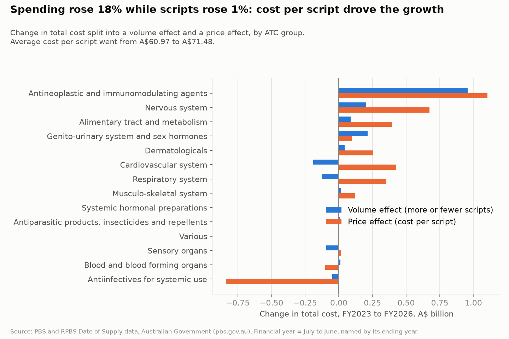
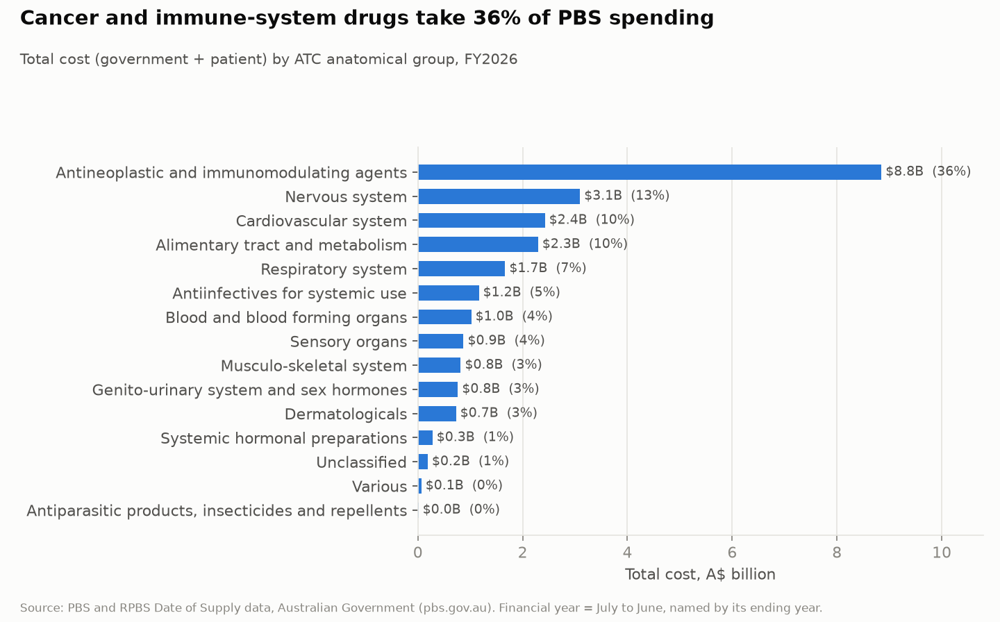
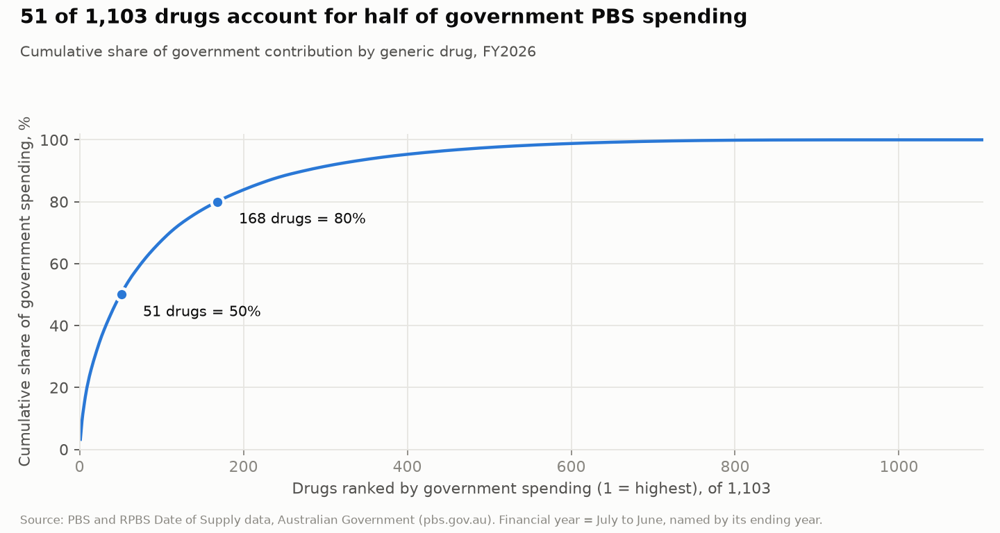
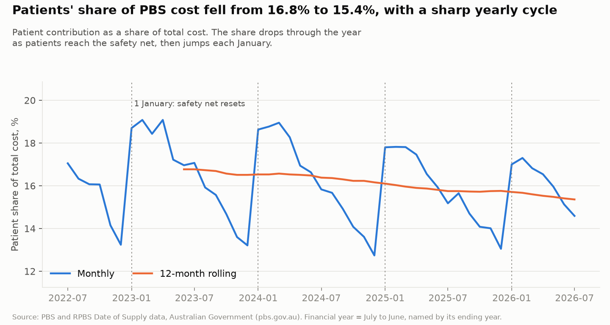
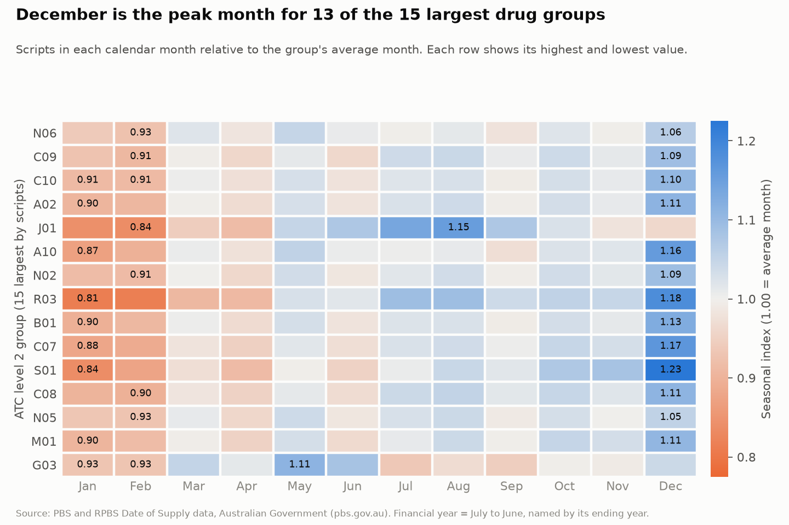

# Australian PBS Prescription Spending Analysis (FY2023–FY2026)

A SQL analysis of four years of Australian Pharmaceutical Benefits Scheme (PBS) prescription data:
1.16 million rows of public government data, modelled as a star schema in PostgreSQL and used to
answer five questions about where the money goes, who pays, and what drives the growth.

**Stack:** PostgreSQL 16 · SQL (window functions, CTEs) · Python (pandas, matplotlib) · Streamlit · Claude API (tool calling) · DuckDB

The project also includes an **AI data assistant** that answers questions about the data in plain English or Chinese, with its own evaluation set ([details below](#ai-data-assistant)).

**Live dashboard:** https://pbs-spending-analysis-vbe9zbgmxyccemd7vynfud.streamlit.app

## Key findings

**1. Spending grew 18% in three years while script volume grew 1%.**
Total cost rose from A$20.5B (FY2023) to A$24.2B (FY2026). A price–volume decomposition attributes
A$3.56B of the A$3.75B increase to a higher average cost per script (A$60.97 → A$71.48) and only
A$0.19B to more scripts.



**2. Cancer and immune-system drugs take 36% of all spending.**
ATC group L (antineoplastic and immunomodulating agents) cost A$8.8B in FY2026 from only 6.8 million
scripts, about 2% of all scripts. Cardiovascular drugs are the reverse: the most scripts (100.6 million)
but 10% of cost.



**3. Half of government spending goes to 51 drugs.**
Of 1,103 generic drugs supplied in FY2026, 51 account for 50% of government spending and 168 for 80%.
The top of the list is dominated by high-cost specialty medicines: government cost per script ranges
from A$65 (apixaban) to over A$20,000 (a cystic fibrosis therapy) within the top 20.



**4. Patients' share of cost is falling, and follows a strong yearly cycle.**
The 12-month rolling patient share fell from 16.8% to 15.4%. Within each year the share drops from
about 18–19% in January to about 13% in December as patients reach the PBS Safety Net, then resets
on 1 January. For general patients, the share of scripts priced under the co-payment fell from 76%
(2025) to 70% (January–July 2026), which coincides with the general co-payment cut to A$25 on
1 January 2026.



**5. December is the peak month for 13 of the 15 largest drug groups.**
The seasonal pattern is driven mainly by the scheme's rules rather than by illness: scripts peak in
December (index up to 1.23) and fall in January (down to 0.81), in step with the Safety Net cycle.
Systemic antibacterials (J01) are the exception, peaking in the Australian winter (August, 1.15).



Findings 4 and 5 describe timing that matches known policy dates. The data cannot prove that the
policies caused the changes.

## Data

| | |
|---|---|
| Source | [PBS and RPBS Section 85 Date of Supply data](https://www.pbs.gov.au/info/statistics/dos-and-dop/dos-and-dop), Australian Government |
| Downloaded | 4 October 2026 |
| Coverage | July 2022 – July 2026 (49 months); four full financial years, FY2023–FY2026 |
| Size | 1,160,293 rows; 7,456 PBS item codes; 1,171 generic drug names |
| Grain | month × item code × patient category × program × script type |

Things to know about the data:

- It is aggregated. There are no patient-level records, so this project analyses totals, structure and
  trends, not individual behaviour.
- The Australian financial year runs July to June. Here FY2024 means July 2023 – June 2024. Yearly
  comparisons use only financial years with all 12 months (July 2026 is excluded from them).
- Costs are in Australian dollars. Total cost = patient contribution + government contribution.

## Data model

A star schema with one fact table and four dimension tables ([sql/02_schema.sql](sql/02_schema.sql)).

| Table | Rows | Content |
|---|---|---|
| `fact_supply` | 1,160,293 | scripts and dollar amounts at the grain above |
| `dim_month` | 49 | month, calendar year, financial year |
| `dim_item` | 7,456 | drug name, form/strength, ATC codes at levels 1, 2 and 5 |
| `dim_atc1` | 15 | the 14 WHO ATC anatomical groups, plus "Unclassified" |
| `dim_patient_cat` | 8 | patient category, scheme group, safety-net flag |

Design choices:

- Money is stored as `numeric`, not float. The source file carries floating-point noise
  (e.g. `43774.5899999999`), which is rounded to cents on load so that sums are exact.
- ATC classification lives on the item dimension, so spending can be rolled up to any ATC level
  without touching the fact table.
- ATC codes in the source have different lengths (1, 4, 5 or 7 characters). Level 2 is filled only
  when the code is long enough; 30 item codes with no usable ATC code are grouped as "Unclassified".

## Data quality

Nine checks in [sql/03_quality_checks.sql](sql/03_quality_checks.sql), all run before the analysis.

| # | Check | Result |
|---|---|---|
| 1 | Row counts: converter output = staging = fact | 1,160,293 at each step |
| 2 | Non-numeric values in numeric columns | 0 |
| 3 | Missing values in key columns | 0 |
| 4 | Category values match the PBS explanatory notes | yes; no "UK" patient category appears |
| 5 | Duplicate rows at the fact grain | 0 |
| 6 | Item codes mapped to more than one drug name or ATC code | 0 |
| 6b | Items missing from the PBS item map / unclassified ATC | 2 / 30 of 7,456 |
| 7 | Missing months | 0 |
| 8 | Total cost ≠ patient + government contribution | 0 rows |
| 9 | Negative values, or government cost on under-co-payment scripts | 0 |

Two problems were found and fixed while loading: the workbook splits the data across five sheets
(one per financial year), and the item map file is Windows-1252 encoded, which PostgreSQL rejects.

## Analysis

| # | Question | Method | SQL |
|---|---|---|---|
| 1 | Which drug groups cost the most and grow fastest? | share of year, year-on-year growth with `LAG`, `RANK` | [05](sql/05_a1_category_spend.sql) |
| 2 | How is cost split between government and patients? | 12-month rolling window, `FILTER` aggregates | [06](sql/06_a2_burden_share.sql) |
| 3 | How concentrated is government spending? | running total over ranked drugs (Pareto) | [07](sql/07_a3_concentration.sql) |
| 4 | Which drug groups are seasonal? | seasonal index, window over aggregates | [08](sql/08_a4_seasonality.sql) |
| 5 | Is growth driven by volume or by cost per script? | price–volume decomposition | [09](sql/09_a5_price_volume.sql) |

The price–volume decomposition splits the change in cost exactly into two parts, where Q is scripts
and P is cost per script:

```
C1 - C0 = (Q1 - Q0) * P0     volume effect
        + (P1 - P0) * Q1     price effect
```

At group level the "price effect" includes changes in the mix of drugs, not only price changes.

## Query optimisation

Median of three runs with `EXPLAIN (ANALYZE, BUFFERS)`
([10a](sql/10a_baseline.sql), [10b](sql/10b_indexes.sql), [10c](sql/10c_after.sql)).

| Query | Before | After | What changed |
|---|---|---|---|
| A: one drug's monthly trend | 98.9 ms | 2.8 ms | composite index on `(item_code, month_key)` |
| B: yearly totals by drug group, on the fact table | 307.4 ms | 251.4 ms | nothing useful: the query reads almost every row, so an index cannot help |
| B: same result from a materialised view | 307.4 ms | 35.4 ms | pre-aggregation from 1,160,293 to 136,567 rows |

The index makes the selective query about 36 times faster and leaves the full-table aggregate
unchanged. The aggregate is fixed by pre-aggregating, which makes it about 9 times faster.

## AI data assistant

The dashboard answers the questions I chose. Users still had to wait for someone to write SQL for any
other question, so I added a page where they can ask in plain English or Chinese
([app/pages/2_Ask_the_data.py](app/pages/2_Ask_the_data.py)).

### How it works

1. The question goes to an LLM (Claude) with one tool, `run_sql`, and a description of the table
   ([assistant/agent.py](assistant/agent.py)).
2. The model writes a SQL query; the app runs it with DuckDB on the same monthly data as the dashboard.
3. If the query fails, the error goes back to the model, which fixes the SQL and tries again
   (at most 4 tool calls).
4. The answer gives the key number first, then up to three points, and ends with a one-line
   definition of how the number was calculated. The SQL and result table are shown under it.

Safety and correctness rules:

- **Read-only.** `check_sql` in [assistant/db.py](assistant/db.py) accepts a single `SELECT`/`WITH`
  statement and rejects write keywords, so the model cannot change the data. Results are capped at 200 rows.
- **Business rules in the prompt.** Ten data definitions the model would otherwise guess
  ([assistant/prompts.py](assistant/prompts.py)): financial years are named by their ending year,
  only FY2023–FY2026 are complete, "spending" means total cost, patient share is a ratio of sums,
  unclassified items are excluded from drug rankings, and so on.
- **Refuse what the data cannot answer.** Questions about hospitals, states, individual patients,
  years outside the data, forecasts or causes should be declined, not answered with a guess.

### Evaluation

Every question has a reference SQL query; [eval/run_eval.py](eval/run_eval.py) runs it and the assistant,
then checks that every value in the reference result appears in the assistant's query results or in
the numbers written in its answer (within 1%, allowing for unit changes and rounding).
Out-of-scope questions pass if the answer says the data cannot answer them.

| Set | Questions | What it covers |
|---|---|---|
| Development ([questions.json](eval/questions.json)) | 30 | 10 question types (totals, growth, ratios, rankings, financial-year definitions, drug lookups, …) + 5 out-of-scope |
| Held-out test ([questions_test.json](eval/questions_test.json)) | 15 | written after the prompt was finished: colloquial wording, ambiguous questions, multi-step calculations, mixed-up measures, 1 out-of-scope. Ambiguous questions accept several reasonable answers |

Results (prompt v1 = table description only, v2 = v1 + the ten business rules):

| Model | Prompt | Development (30) | Held-out test (15) |
|---|---|---|---|
| Claude Sonnet 5.5 | v1 | 30 | 15 |
| Claude Sonnet 5.5 | v2 | 30 | 15 |
| Claude Haiku 5.5 | v1 | 30 | 15 |
| Claude Haiku 5.5 | v2 | 30 | 15 |

All four configurations answered all 45 questions correctly, and all 6 out-of-scope questions were declined.
The default model is therefore **Haiku**, the cheaper and faster one.

What the evaluation taught me:

- **The grader had bugs before the model did.** The first run scored v1 at 72% and v2 at 68%, which
  suggested the business rules made things worse. Checking the failures showed the grader only looked
  at the last query and missed growth rates the model calculated in its answer text. A second fix added
  refusal phrasings such as "doesn't say". After the fixes every configuration scored 100%.
- **A 100% score is a ceiling, not a result.** Because every configuration is perfect, this set cannot
  show whether the business rules help. That is why the judge below grades answer quality as well.
- **The grader is lenient.** A 1% tolerance plus rounding means a nearby number can pass
  (for example 51 counted as matching 50). This is a known limitation.

### Second layer: LLM-as-a-Judge

The number check gives every configuration 100%, so it cannot say which answers are *better*.
[eval/judge.py](eval/judge.py) adds a second layer: a different model (Claude Sonnet) reads each saved
answer, every query the assistant ran (up to 50 rows each) and the business rules, and scores five
criteria from 0 to 2 (total 10):

| Criterion | What it checks |
|---|---|
| faithful | every number is in the query results, follows from them, or comes from the rules |
| direct | the first line answers the question |
| definition | the answer says how the number was calculated |
| concise | no filler or repetition, at most about three points |
| scope | declines what the data cannot answer; does not wrongly refuse or claim causes |

Held-out test set, Haiku 5.5:

| Prompt | Number check | faithful | direct | definition | concise | scope | Judge total |
|---|---|---|---|---|---|---|---|
| v1 (no business rules) | 15/15 | 1.67 | 2.00 | 1.80 | 1.80 | 2.00 | 9.3 / 10 |
| v2 (with business rules) | 15/15 | 1.80 | 1.93 | 1.93 | 1.93 | 1.87 | 9.5 / 10 |

**Checking the judge.** I re-ran the queries by hand for four answers the judge marked down, and the judge
was right each time ([eval/judge_spotcheck.md](eval/judge_spotcheck.md)). Two of them are wrong numbers in
the answer text that the number check had passed, for example a year-on-year growth of +2.1% written
where the data gives +5.1%. This is the main value of the second layer.

**What it does not show.** v2 scores slightly higher than v1, but with 15 questions the gap (0.2 points)
is within the noise, so I do not claim the business rules improve answers.

Building the judge took three versions: plain-text JSON was cut off or mixed with reasoning; forcing
the tool call is not supported by this model (HTTP 400); the final version offers a scoring tool, parses
JSON from text as a fallback, retries, and leaves failed judgements out of the averages instead of
counting them as 0. The first version also only showed the judge the first 5 rows of the last query,
so it marked correct numbers as unsupported; the assistant now records every query it runs.

```bash
python3 -m eval.judge eval/results_test_claude-haiku-5-5_v1.csv eval/results_test_claude-haiku-5-5_v2.csv
python3 -m eval.judge --summary
```

Run it yourself (needs `ANTHROPIC_API_KEY`):

```bash
python -m eval.run_eval            # development set, prompt v1 and v2
python -m eval.run_eval --test v2  # held-out test set, prompt v2
LLM_MODEL=claude-sonnet-5-5 python -m eval.run_eval   # another model
```

Results are written to `eval/results_<set>_<model>_<version>.csv`. The app also logs each question
and the user's thumbs-up or thumbs-down to `logs/questions.csv` (not committed), to collect real
questions for the next version of the evaluation set.

## How to reproduce

Requires PostgreSQL 16 and Python 3.10+.

```bash
# 1. Download from the PBS page linked above into data/raw/:
#    the monthly Date of Supply report (XLSX) and the item drug map (CSV)

pip install -r requirements.txt
createdb pbs

# 2. Convert and clean the source files
python scripts/xlsx_to_csv.py data/raw/dos-jul-2022-to-jul-2026.xlsx data/pbs_dos.csv
python scripts/clean_item_map.py data/raw/pbs-item-drug-map.csv data/item_map.csv

# 3. Load, model and check
psql pbs -f sql/01_staging.sql
psql pbs -f sql/02_schema.sql
psql pbs -f sql/03_quality_checks.sql
psql pbs -f sql/04_views.sql

# 4. Baseline timings, then indexes and the materialised view
psql pbs -f sql/10a_baseline.sql
psql pbs -f sql/10b_indexes.sql
psql pbs -f sql/10c_after.sql

# 5. Run the analyses, export results, draw figures, open the dashboard
python scripts/export_results.py
python scripts/make_figures.py
streamlit run app/Home.py

# 6. Optional: the AI data assistant page needs an API key
export ANTHROPIC_API_KEY=...   # keep it out of the repo
```

## Limitations

- No patient-level data: no cohort, adherence or demographic analysis is possible.
- Script counts are not the same as medicine use. Since September 2023, 60-day prescriptions let one
  script cover twice the supply for some medicines, which lowers script counts and raises cost per
  script without any change in use. This affects every comparison based on script counts,
  including findings 1 and 5.
- Costs are as published. The PBS notes state that expenditure on two drugs (nusinersen and
  onasemnogene abeparvovec) excludes manual payments, and the retail mark-up is a formula value.
- The seasonal index is not de-trended, so groups with strong growth are slightly overstated in the
  later months of the financial year.
- The analysis shows what changed and when. It does not establish causes.
- The AI assistant's evaluation set is small (45 questions) and every configuration scores 100%, so it
  shows the assistant works on these questions but cannot rank the configurations. The LLM judge is
  itself a model and can be wrong; it was spot-checked on four answers, not validated at scale.

## Policy dates referred to above

- 1 January 2023: general patient co-payment reduced from A$42.50 to A$30.00
  ([PBS Expenditure and Prescriptions Report 2023–24](https://www.pbs.gov.au/info/statistics/expenditure-prescriptions/expenditure-prescriptions-report-1-july-2023-30-june-2024)).
- 1 September 2023: 60-day prescriptions begin (stage 1), with stages 2 and 3 on 1 March and
  1 September 2024 (same report).
- 1 January 2026: general patient co-payment reduced from A$31.60 to A$25.00
  ([Parliament of Australia, Bills Digest](https://www.aph.gov.au/Parliamentary_Business/Bills_Legislation/bd/bd2526/26bd011)).

Data source: Australian Government Department of Health, Disability and Ageing, PBS statistics.
